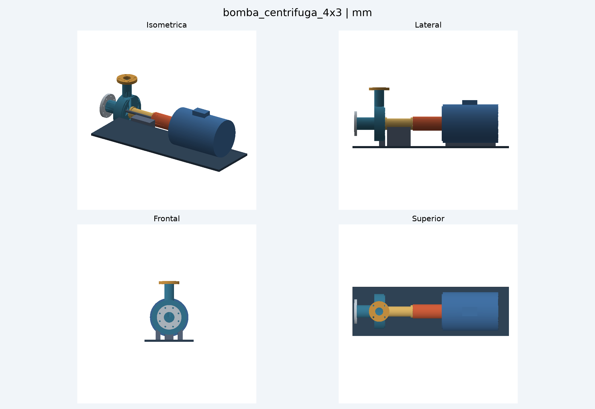
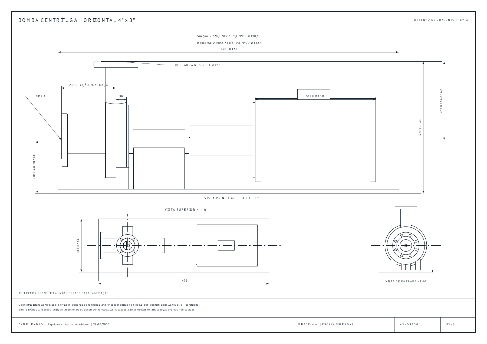

# Forge Hardware

[English (primary)](README.md) · [Português](docs/pt-BR.md) · [Español](docs/es.md)

**Describe hardware. Keep editable source. Rebuild real CAD and robot files locally.**

Forge Hardware gives an AI coding agent a practical workflow for turning plain-language ideas into parametric Python designs, inspecting their geometry, and making precise follow-up changes. The agent writes the source; build123d/OpenCascade generates the geometry. No hosted backend, cloud CAD account or LLM API key is required by the toolkit.

## Featured project · Centrifugal pump 4″ × 3″

### Model overview
Isometric, side, front and top views of the pump, coupling, motor and base.

[](bomba_centrifuga_4x3_4vistas.png)

### Technical reference sheet
Assembly layout with dimensions and orthographic views. Open the image to inspect the details.

[](prancha-3.png)

*Visual project references; the drawing is marked as not released for fabrication.*

## More CAD demonstrations


**[See three complex, tested demonstrations →](demos/README.md)** — split bearing housing, parallel robotic gripper and serpentine cooling plate; editable sources, real CAD images and reproduction commands.

## Quick start

Use Python 3.11–3.13 on a platform with build123d/OpenCascade wheels. Python 3.12 on Linux is tested. Native dependencies may require additional platform setup; start with a clean virtual environment rather than an existing CadQuery environment.

```bash
git clone https://github.com/C48H74/forge-hardware.git
cd forge-hardware
python -m venv .venv
# Linux/macOS
source .venv/bin/activate
# Windows PowerShell instead: .venv\Scripts\Activate.ps1
python -m pip install -e '.[dev]'

forge build examples/fixture.py -o build/fixture
forge view build/fixture
```

Open **http://127.0.0.1:8740** on the computer running the viewer. Drag to orbit, scroll to zoom, and select parts or named features. The viewer uses only local assets, including its renderer; it has no CDN dependencies. The CLI also works as `python -m forge_hardware`.

## Install the coding-agent skill

Copy `skills/forge-hardware` into your agent's skill directory, or point the agent directly at its `SKILL.md`. For Codex CLI, for example:

```bash
mkdir -p ~/.codex/skills
cp -R skills/forge-hardware ~/.codex/skills/forge-hardware
```

For ChatGPT Work, install through its personal skill workflow; copying into a terminal path does not install it into a separate ChatGPT account. See [agent setup](docs/agents.md) for the CLI and optional legacy MCP stdio interface.

Try:

> Use $forge-hardware to create a 90 × 60 × 8 mm fixture plate with four 5.5 mm holes, 10 mm from each edge. Export CAD and a cutting profile. Show me a geometry preview.

Then:

> Enlarge only `base/hole_front_left` to 6.5 mm and regenerate the files. Preserve the other holes and the plate dimensions.

The agent edits that feature's construction in Python. Global `hole_diameter` changes all four holes; the skill explicitly distinguishes these two requests.

## Outputs

| Capability | Output and scope |
|---|---|
| Exact CAD exchange | STEP, with named assembly parts |
| Printing and mesh exchange | STL, 3MF and binary glTF/GLB |
| Cutting geometry | DXF + SVG from **explicit XY flat patterns** |
| Review | Isometric SVG, engineering projections, tessellated local scene, references and DFM JSON |
| Robot interchange | URDF, SRDF, SDF and adjacent link STL meshes |
| Follow-up edits | Named parameters and semantic references; build-specific face descriptors |
| Purchased components | Searchable public STEP index, supplier search links, direct STEP downloads with SHA256 provenance |
| Agent integration | CLI, five legacy MCP stdio tools, optional React iframe host and typed view protocol |

A build emits only the formats applicable to its source: DXF requires a declared flat pattern; robot XML requires robot metadata. STEP/3MF/GLB assemblies use zero-pose transforms, and robot meshes remain in local link coordinates.

## Edit and regenerate

```bash
forge build examples/fixture.py -o build/fixture --params '{"length":110,"thickness":10}'
forge refs build/fixture
```

Keep Python source in your project. `manifest.json` records the source hash, effective parameters, output hashes and elapsed build time. Failed builds leave the previous successful output intact; unmanaged directories are never replaced. See [modeling contract](docs/modeling.md).

## Search, download and use purchased parts

```bash
forge catalog refresh
forge catalog search '608 bearing'
forge catalog search 'NEMA motor'
forge catalog search 'M3 screw' --suppliers
forge catalog search 'JST connector' --suppliers
```

The default inventory indexes STEP files in the public FreeCAD library at an immutable revision. Searching is local after refresh. Manufacturer inventory, stock and licensing are not inferred from filenames. Supplier results are search links; vendors may require a browser login or manual download.

```bash
# Paste a verified direct HTTPS STEP URL returned by search:
forge catalog download 'https://raw.githubusercontent.com/OWNER/REPO/COMMIT/path/part.step' assets/part.step
```

```python
from forge_hardware.cad.step import load_part
bearing = load_part('assets/part.step', 'bearing_608')
# Include bearing in Design.parts; transform its shape with build123d Locations.
```

The downloader rejects HTML/login pages, Git LFS pointers, oversized downloads, non-STEP responses and hash mismatches. It keeps a `.step.json` provenance record. Check dimensions and the original part license before use or redistribution. See [parts workflow](docs/parts.md).

## Robots

```bash
forge build examples/robot_arm.py -o build/robot_arm
forge view build/robot_arm
```

Select a link or move the joint slider. URDF and SDF preserve local frames and explicit SI mass/inertia data; SRDF contains author-defined joint groups. Supported joints: fixed, revolute, continuous and prismatic. The runtime rejects disconnected graphs, cycles, bad axes, invalid limits and nonphysical inertia tensors.

Collision geometry currently uses visual meshes. Closed loops, mimic joints, controllers, transmissions, collision planning and automatic inertia estimation are outside this version. Files are tested structurally and geometrically; Gazebo/MoveIt integration has not been run. See [robot conventions](docs/modeling.md#robots).

## Architecture

The implementation follows the supplied diagram: model scripts → STEP operations → build daemon → artifacts, alongside CAD runtime; viewer server/client → render assets → surface tessellation; agent tools → embedded viewer → versioned view protocol. DFM, drawing generation and fabrication handoff are separate capabilities.

Read [architecture and diagram](docs/architecture.md). `App.tsx` is an optional React embedding adapter; the default browser viewer needs no React build step. Fabrication handoff lists provider websites and generated files; it never uploads designs, submits quotes or orders parts.

## Tests and benchmarks

```bash
python -m pytest -q
python benchmarks/run.py --runs 3
node tests/viewer.mjs
```

See [measured results](benchmarks/results.json). Timings measure warm-process geometry plus exports, not AI latency, cold startup or design quality. Tests exercise real geometry and file roundtrips, precise edits, robot frames, download validation and the agent protocol. CI runs the Python tests on Linux with Python 3.11 and 3.12.

## Practical limits

DFM screening checks envelopes and author-declared thicknesses. Review drawings are not toleranced production drawings; flat-pattern authoring does not automatically unfold sheet metal. The offline viewport uses tessellated surfaces and depth buffering; inspect STEP in a CAD tool for final exact geometry review. Trusted model scripts execute Python with your user permissions. Neither the daemon nor MCP tools provide a code sandbox.

## References and license

Implementation references: [build123d export API](https://build123d.readthedocs.io/en/stable/import_export.html), [ROS URDF tutorials](https://docs.ros.org/en/rolling/Tutorials/Intermediate/URDF/URDF-Main.html), [SDF specification](https://sdformat.org/spec?ver=1.9), [MCP legacy stdio transport](https://modelcontextprotocol.io/specification/2024-11-05/basic/transports), and [FreeCAD parts library](https://github.com/FreeCAD/FreeCAD-library). APIs were checked during development; build123d is pinned to 0.12.0.

Toolkit code is MIT licensed. External part models retain their original licenses. [Português: guia rápido](docs/pt-BR.md).
