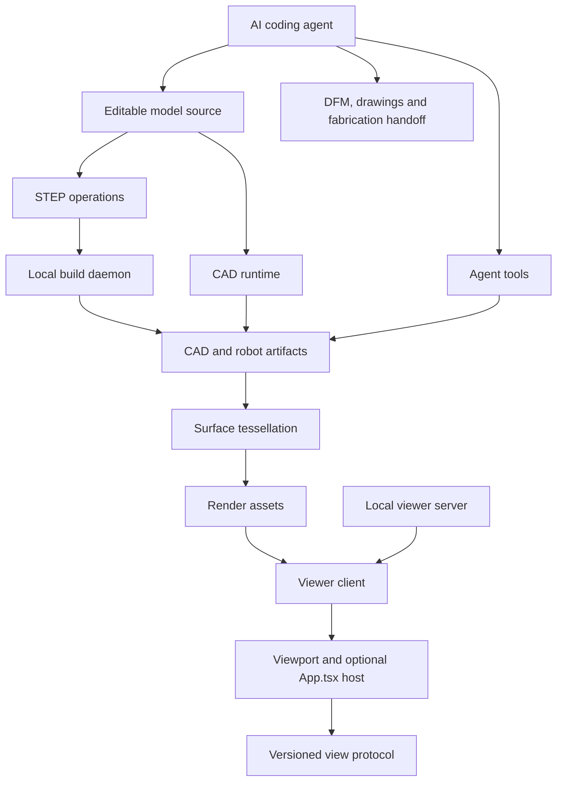

# Architecture

The supplied diagram is implemented as explicit modules. The executable baseline is Python plus a dependency-free local browser viewer. React embedding is optional.

| Diagram block | Implementation | Responsibility |
|---|---|---|
| CAD model scripts | `examples/*.py` and project-local sources | Parameters and design intent |
| CAD runtime `[build123d.py]` | `forge_hardware/cad/build123d.py` + pinned build123d | Design/Part contract and real BRep kernel |
| STEP operations `[step.py]` | `forge_hardware/cad/step.py` | STEP imports and build-daemon requests |
| Build daemon `[server.py]` | `forge_hardware/daemon/server.py` | Serialized authenticated build subprocesses |
| CAD artifacts `[artifacts.py]` | `forge_hardware/cad/artifacts.py` | Exports, manifest and successful-output publication |
| Viewer server `[main.py]` | `forge_hardware/viewer/main.py` | Read-only loopback assets |
| Viewer client `[client.js]` | `forge_hardware/viewer/client.js` | Scene, references, downloads, robot UI |
| Viewport runtime | `forge_hardware/viewer/runtime.js` | Orbit, picking and forward kinematics |
| Render assets / surface tessellation | `forge_hardware/viewer/tessellation.py` | Exact-surface tessellation and deterministic review images |
| Browser / embedded viewer `[App.tsx]` | `forge_hardware/viewer/App.tsx` | Optional same-origin React iframe adapter |
| MCP tools `[server.py]` | `forge_hardware/agent/server.py` | Agent build/inspect/preview/search/download tools |
| View protocol `[server.ts]` | `forge_hardware/agent/server.ts` | Typed versioned selection events and commands |
| DFM checks | `forge_hardware/capabilities.py` | Envelope and declared-thickness checks |
| Engineering drawings | `forge_hardware/cad/artifacts.py` | BRep projections exported as SVG |
| Fabrication services | `forge_hardware/capabilities.py` | Explicit manual provider handoff |

## Two independent local services

`forge view build/fixture` serves only the selected build directory on loopback port 8740. It has no build or upload endpoint. Static assets are copied into the output directory when launching the viewer. Refresh after a rebuild. It does not watch files automatically.

`forge daemon --workspace /absolute/project` listens on loopback port 8741 and prints a per-process token. Pass that token to `request_build` from `cad.step`; source and output paths must resolve inside the workspace. It executes one trusted Python source at a time in a subprocess with a 300 second timeout. Do not expose it to the network. The token and path checks are request controls, not a Python sandbox.

The agent CLI and MCP may build directly without starting the HTTP daemon. `cad.step.request_build` is the optional dispatch path depicted in the diagram.

## Embedding

Bundle `viewer/App.tsx` and `agent/server.ts` into a React application you already control. Serve its iframe URL on the same origin. Selection events contain `{type:'forge.selection', version:1, design, ref}`. Hosts must check both message origin and iframe source. Use `sendViewCommand` for `forge.select` and `forge.reset`. Part IDs are supported by `forge.select`; user-facing semantic feature selection is available through the viewer's feature buttons.

The default renderer needs no npm dependency or CDN. It consumes generated `scene.json`; it does not parse arbitrary external STEP, GLB or URDF files in the browser. Import a STEP or author robot metadata and regenerate through the toolkit to inspect them. Robot XML remains available as downloadable/source-viewable artifacts.
